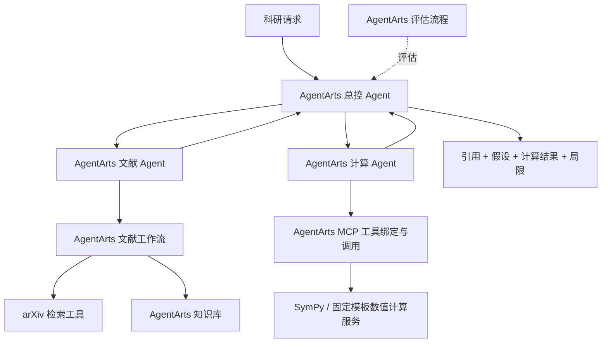

# 架构与验收边界

状态：设计方案；账号版本与能力以 M0 实测为准。

## 实现责任

| 能力 | 必须落点 | 仓库保存内容 |
| --- | --- | --- |
| 总控与协作 | AgentArts 多智能体/工作流编排 | 提示词、节点与变量说明、导出配置（若支持）、运行证据 |
| 工具选择、绑定、调用 | AgentArts MCP/插件与工作流 | 工具 schema、受限计算服务实现、接口说明 |
| 文献知识管理 | AgentArts 知识库及接入功能 | 结构化文献卡、来源与去重策略、导入说明 |
| 效果评估 | AgentArts 评测任务及报告 | 评测输入、预期结果、报告导出或脱敏记录 |
| 发布部署 | AgentArts 发布/运行能力 | 平台版本、部署步骤、应用版本、可复现证据 |

外部 MCP 服务不执行任务规划、模型路由或另一个 Agent 循环。初期计算工具优先 SymPy，不依赖 Wolfram Alpha 的账号/计费。

## 最小闭环

1. 总控确认主题、时间范围或数学假设；信息不足先提问。
2. 文献 Agent 检索并生成卡片，按 arXiv ID + 版本去重。保留检索时间、论文更新时间、原始来源；检索失败时不得声称「没有新论文」。
3. 将许可范围内的结构化摘要/笔记接入平台知识库。全文不可得时仅总结摘要，不推断完整实验结论。自动写入能力需实测；手工导入可用于 M0，但不能在最终演示中冒充自动入库。
4. 计算 Agent 接收明确表达式、变量域与假设，通过平台调用受限工具；返回工具输入、输出、版本与限制。
5. 总控将文献证据与计算结果并列呈现，区分「符号化简成立」「发现反例」「数值样本支持」「条件不足/无法判定」。数值采样通过不是数学证明，局部核验也不是整篇论文结论证明。

主题追踪第一版允许用户点击「检查更新」触发 AgentArts 工作流；定时触发仅在平台能力验证后加入，不在外部搭建 Agent 调度系统。

## 工具约束

- 数学工具只接受结构化参数和白名单操作，禁止直接执行模型生成的任意 Python、shell 或任意字符串 `eval`。
- 限制表达式长度、计算时间、样本数量；超时/无结果作为显式状态返回。
- 数值实验限固定模板，保存随机种子、参数和误差阈值。
- 凭证放平台密钥配置或本地环境，不进入仓库；论文正文作为数据处理，不作为总控指令。

## M4 验收目标（待实现，非当前成绩）

平台内执行至少 12 条固定用例：文献 4 条、计算 4 条、联合任务 2 条、失败/条件不足 2 条。每条有人工核对的预期、平台运行记录和结果说明。

- 所有文献结论有可访问的对应来源；无来源时明确未知。
- 预设正确式、错误式、缺条件与超时案例均按预期分类，不允许把采样当证明。
- 两条联合任务完整走过平台总控、子 Agent、工具与报告链路。
- 同伴能根据部署说明复现；记录延迟与实际调用成本，不虚构提升百分比。
- 效率比较使用同一任务的人工基线与 Agent 辅助流程，记录耗时和错误，不以一次演示推断普遍提升。
